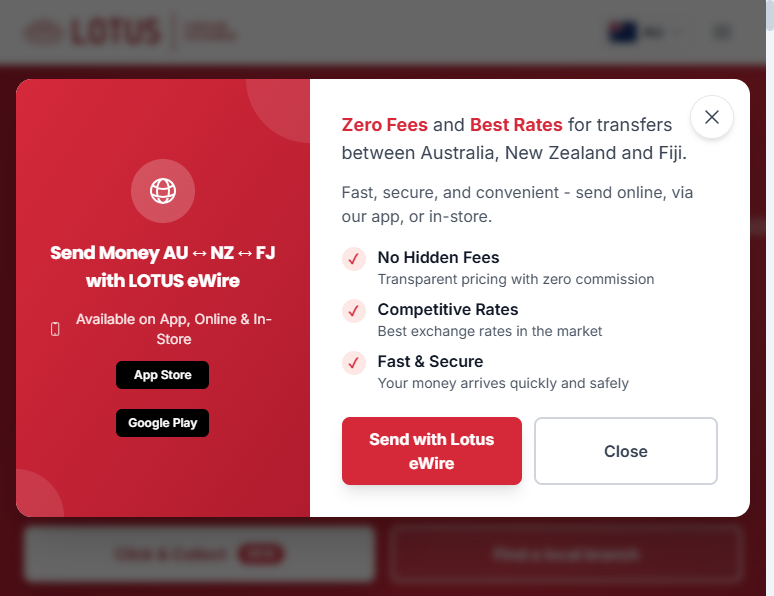
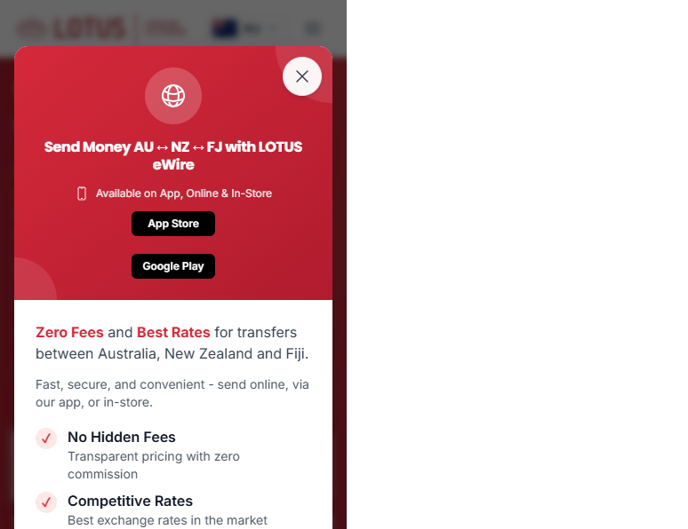

# Promo popup template ("the eWire popup style")

Saved design for a homepage advertisement popup. It was used to promote Lotus eWire and was
switched off on 11 Oct 2026. When asked for "a popup like the eWire one" or "use the popup
style for <campaign>", reuse this design and only change the wording, icon, buttons and link.

The working component is still in the repo: `components/PopupModal.tsx` (not rendered anywhere).

## Screenshots

Desktop — two columns: red brand panel on the left, white content panel on the right.



Mobile — the red panel stacks on top; the whole card scrolls inside the screen.



## Design rules

| Part | Style |
|---|---|
| Backdrop | `bg-black/60 backdrop-blur-sm`, click to close |
| Card | white, `rounded-2xl shadow-2xl max-w-4xl`, `max-h-[90vh]` scrollable |
| Entrance | framer-motion spring: fade + scale 0.9 → 1 + slide up 20px, ~0.5s |
| Layout | `md:grid-cols-[1.2fr_1.8fr]`; stacks on mobile |
| Left panel | `bg-gradient-to-br from-primary-600 to-primary-700`, centred white text, two soft white circles (`bg-white/10`) top-right and bottom-left |
| Left content | round icon badge (`w-16 h-16 bg-white/20`), bold headline, small availability line with phone icon, black App Store / Google Play buttons |
| Right panel | intro line with key words in `text-primary-600 font-bold`, grey sub-line, 3 benefits with round pink tick badges (`bg-primary-100` + red ✓), title + grey description |
| Buttons | primary red filled (`bg-primary-600`, shadow, lifts on hover) + outlined grey "Close", side by side on desktop, stacked on mobile |
| Close (X) | top-right white circle `w-11 h-11` with shadow, above the red panel so it is tappable on mobile |

## Behaviour

- Opens immediately on first visit of the browser session (no delay).
- Remembers it was seen with `sessionStorage['lotusfx-popup-seen']`, so it shows once per session.
- Closes on X, "Close" button, or clicking the backdrop.
- Analytics: `popup_interaction` (`close` / `send_money`) and `cta_click` (`popup_ewire`).
- Text adapts to the visitor's country (AU / NZ / FJ). Fiji hides the app buttons
  (`getCountryPortalLinks(country).showApps`).

## How to reuse for a new campaign

1. Copy `components/PopupModal.tsx` to e.g. `components/PromoPopup.tsx` (or edit it in place).
2. Change: headline (`getCountryMessage`), icon (`GlobeAltIcon`), intro + sub-line, the 3
   benefits, the primary button label and its link (`handleSendMoney` → `window.location.href`).
3. Use a new sessionStorage key per campaign (e.g. `lotusfx-popup-<campaign>-seen`) so people
   who closed the old popup still see the new one.
4. Render it on the page(s) you want — for the homepage add `<PopupModal />` back into
   `app/page.tsx` (it was placed right after `<StructuredData />`).
5. Rename the analytics `cta_name` to match the campaign.

## Full source (as of 11 Oct 2026)

```tsx
'use client'

import { useState, useEffect } from 'react'
import { motion, AnimatePresence } from 'framer-motion'
import { XMarkIcon, DevicePhoneMobileIcon, GlobeAltIcon } from '@heroicons/react/24/outline'
import { useCountry } from '@/context/CountryContext'
import { trackEvent } from '@/lib/analytics'
import { getCountryPortalLinks } from '@/lib/country-portals'
import CountryAppLinks from '@/components/CountryAppLinks'

export default function PopupModal() {
  const [isOpen, setIsOpen] = useState(false)
  const { selectedCountry } = useCountry()
  const portal = getCountryPortalLinks(selectedCountry)

  useEffect(() => {
    const hasSeenPopup = sessionStorage.getItem('lotusfx-popup-seen')
    if (!hasSeenPopup) {
      setIsOpen(true)
    }
  }, [])

  const handleClose = () => {
    trackEvent('popup_interaction', { action: 'close' })
    setIsOpen(false)
    sessionStorage.setItem('lotusfx-popup-seen', 'true')
  }

  const handleSendMoney = () => {
    trackEvent('popup_interaction', { action: 'send_money' })
    trackEvent('cta_click', { cta_name: 'popup_ewire', location: 'homepage_popup' })
    setIsOpen(false)
    sessionStorage.setItem('lotusfx-popup-seen', 'true')
    window.location.href = '/money-transfer'
  }

  const getCountryMessage = () => {
    switch (selectedCountry) {
      case 'NZ':
        return 'Send Money NZ ↔ AU ↔ FJ with LOTUS eWire'
      case 'FJ':
        return 'Send Money FJ ↔ AU ↔ NZ with LOTUS eWire'
      default:
        return 'Send Money AU ↔ NZ ↔ FJ with LOTUS eWire'
    }
  }

  return (
    <AnimatePresence>
      {isOpen && (
        <>
          <motion.div
            initial={{ opacity: 0 }}
            animate={{ opacity: 1 }}
            exit={{ opacity: 0 }}
            onClick={handleClose}
            className="fixed inset-0 bg-black/60 backdrop-blur-sm z-50"
          />

          <motion.div
            initial={{ opacity: 0, scale: 0.9, y: 20 }}
            animate={{ opacity: 1, scale: 1, y: 0 }}
            exit={{ opacity: 0, scale: 0.9, y: 20 }}
            transition={{ type: 'spring', duration: 0.5 }}
            className="fixed inset-0 z-50 flex items-center justify-center p-4"
            onClick={(e) => e.stopPropagation()}
          >
            <div className="bg-white rounded-2xl shadow-2xl max-w-4xl w-full overflow-hidden relative max-h-[90vh] overflow-y-auto">
              <button
                type="button"
                onClick={(e) => {
                  e.preventDefault()
                  e.stopPropagation()
                  handleClose()
                }}
                className="absolute top-3 right-3 sm:top-4 sm:right-4 z-[60] w-11 h-11 rounded-full bg-white/95 hover:bg-white shadow-md border border-gray-200 flex items-center justify-center transition-colors duration-200 touch-manipulation"
                aria-label="Close"
              >
                <XMarkIcon className="w-6 h-6 text-gray-700 pointer-events-none" />
              </button>

              <div className="grid md:grid-cols-[1.2fr_1.8fr] gap-0">
                {/* Left: red brand panel */}
                <div className="bg-gradient-to-br from-primary-600 to-primary-700 p-6 md:p-8 flex flex-col justify-center items-center text-center relative overflow-hidden isolate">
                  <div className="absolute top-0 right-0 w-32 h-32 bg-white/10 rounded-full -mr-16 -mt-16"></div>
                  <div className="absolute bottom-0 left-0 w-24 h-24 bg-white/10 rounded-full -ml-12 -mb-12"></div>

                  <div className="relative z-10">
                    <div className="w-16 h-16 bg-white/20 rounded-full flex items-center justify-center mb-4 mx-auto">
                      <GlobeAltIcon className="w-8 h-8 text-white" />
                    </div>
                    <h3 className="text-base md:text-lg lg:text-xl font-bold text-white mb-3 leading-tight">
                      {getCountryMessage()}
                    </h3>
                    <div className="flex flex-col items-center space-y-3 text-white/90">
                      <div className="flex items-center space-x-2">
                        <DevicePhoneMobileIcon className="w-4 h-4" />
                        <span className="text-xs md:text-sm">
                          {portal.showApps ? 'Available on App, Online & In-Store' : 'Available in-store across Fiji'}
                        </span>
                      </div>
                      {portal.showApps ? (
                        <CountryAppLinks
                          className="flex-col space-y-2 mt-3 gap-2"
                          appStoreClassName="inline-flex items-center justify-center bg-black text-white px-3 py-1.5 rounded-md hover:bg-gray-800 transition-colors text-xs font-semibold w-full"
                          playStoreClassName="inline-flex items-center justify-center bg-black text-white px-3 py-1.5 rounded-md hover:bg-gray-800 transition-colors text-xs font-semibold w-full"
                        />
                      ) : null}
                    </div>
                  </div>
                </div>

                {/* Right: content */}
                <div className="p-6 md:p-8">
                  <div className="space-y-4">
                    <div>
                      <p className="text-base md:text-lg text-gray-700 mb-3">
                        <span className="text-primary-600 font-bold">Zero Fees</span> and{' '}
                        <span className="text-primary-600 font-bold">Best Rates</span> for transfers between{' '}
                        {selectedCountry === 'AU'
                          ? 'Australia, New Zealand and Fiji'
                          : selectedCountry === 'NZ'
                            ? 'New Zealand, Australia and Fiji'
                            : 'Fiji, Australia and New Zealand'}
                        .
                      </p>
                      <p className="text-sm md:text-base text-gray-600">
                        Fast, secure, and convenient - send online, via our app, or in-store.
                      </p>
                    </div>

                    <div className="space-y-2">
                      {[
                        ['No Hidden Fees', 'Transparent pricing with zero commission'],
                        ['Competitive Rates', 'Best exchange rates in the market'],
                        ['Fast & Secure', 'Your money arrives quickly and safely'],
                      ].map(([title, text]) => (
                        <div key={title} className="flex items-start space-x-3">
                          <div className="w-6 h-6 bg-primary-100 rounded-full flex items-center justify-center flex-shrink-0 mt-0.5">
                            <span className="text-primary-600 text-sm font-bold">✓</span>
                          </div>
                          <div>
                            <div className="font-semibold text-gray-900">{title}</div>
                            <div className="text-sm text-gray-600">{text}</div>
                          </div>
                        </div>
                      ))}
                    </div>

                    <div className="flex flex-col sm:flex-row gap-3 pt-2">
                      <button
                        onClick={handleSendMoney}
                        className="flex-1 bg-primary-600 hover:bg-primary-700 text-white font-bold py-2.5 px-6 rounded-lg transition-all duration-200 shadow-lg hover:shadow-xl transform hover:-translate-y-0.5 flex items-center justify-center space-x-2 text-sm md:text-base"
                      >
                        <span>Send with Lotus eWire</span>
                      </button>
                      <button
                        onClick={handleClose}
                        className="flex-1 border-2 border-gray-300 hover:border-gray-400 text-gray-700 hover:text-gray-900 font-semibold py-2.5 px-6 rounded-lg transition-all duration-200 text-sm md:text-base"
                      >
                        Close
                      </button>
                    </div>
                  </div>
                </div>
              </div>
            </div>
          </motion.div>
        </>
      )}
    </AnimatePresence>
  )
}
```
